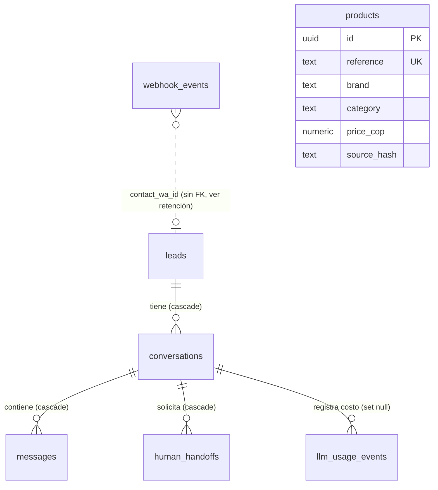

# Modelo de datos — Fase 2 (Supabase PostgreSQL)

Migraciones versionadas en `supabase/migrations/`, aplicadas en orden:

| Archivo | Contenido |
|---|---|
| `20261027100000_core_schema.sql` | Tablas, restricciones, índices, triggers de `updated_at` |
| `20261027100100_rls_and_grants.sql` | RLS en todas las tablas y retirada de privilegios a `anon` y `authenticated` |
| `20261027100200_retention.sql` | Función `purge_expired_personal_data` |
| `20261028100000_products_pricing_search.sql` | Precio anterior, ahorro, disponibilidad, nota de entrega, fecha de extracción y texto de búsqueda en `products` |
| `20261028100100_llm_usage_events.sql` | Auditoría de costos de Claude (`llm_usage_events`) con RLS |
| `20261028100200_handoff_reason_return.sql` | Motivo `return_request` en `human_handoffs` |
| `20261029100000_worker_queue.sql` | Cola del worker (leases, estados), `contact_leases`, `outbound_messages`, `budget_reservations` |
| `20261029100100_retention_worker_safe.sql` | Retención que solo elimina estados finales y respuestas cerradas |
| `20261030100000_whatsapp_delivery.sql` | Estados reales de entrega, lease de envío, fechas de transición y eventos de estado de Meta |

## Entidad-relación

## Tablas

**leads** — prospectos. Clave natural `wa_contact_id` (número internacional sin "+", 6 a 20 dígitos), única.
Campos de atención comercial: `display_name`, `city`, `product_interest`, `budget_cop` (entero ≥ 0), `status`, `acquisition_source`.
Estados: `new`, `qualifying`, `qualified`, `quoted`, `handed_off`, `won`, `lost`, `opted_out`.

**conversations** — sesiones. `status` (`active`, `waiting_customer`, `closed`) y `automation_state` (`automated`, `paused_for_human`, `disabled`).
Restricción: `status = 'closed'` si y solo si `closed_at` tiene valor. Índice único parcial: **una sola conversación no cerrada por prospecto**.

**messages** — contexto conversacional. `direction`, `wa_message_id` (wamid de Meta, único cuando existe), `message_type`, `processing_status`, `received_at`.
`content_text` solo puede existir con `content_expires_at` (restricción). Límite de 4000 caracteres.

**webhook_events** — eventos recibidos de Meta, separados del procesamiento.
- Deduplicación: `UNIQUE (provider, external_event_id)`. El identificador es el **wamid real de Meta**, no un valor generado.
- `payload_sha256`: huella del contenido. Mismo identificador con huella distinta = conflicto (se registra, no se sobrescribe).
- Estado: `received`, `queued`, `processing`, `processed`, `ignored`, `retry`, `dead_letter`.
- Reintentos: `attempts`, `max_attempts`, `next_attempt_at`, `last_error_code` (solo código, sin texto).
- Diagnóstico: `received_at`, `processed_at`, `updated_at`, `expires_at`.
- Índice parcial `webhook_events_pending_idx` para que el worker consulte solo lo pendiente.

**products** — catálogo importado. `reference` es la referencia comercial y clave única de actualización. Desde la migración `20261028100000` incluye `name`, `previous_price_cop` (debe ser mayor que `price_cop`), `savings_cop`, `is_available`, `delivery_note` (texto de la fuente, nunca una fecha), `extracted_on` y `search_text` (texto normalizado sin tildes para búsqueda).
`price_cop` y `price_is_reference` (siempre verdadero): el precio es dato de referencia de la fuente.
`availability_label` y `availability_as_of`: disponibilidad tal como llegó en la fuente, con fecha. No es inventario en tiempo real.

**llm_usage_events** — auditoría de llamadas a Claude. Sin prompts ni respuestas: modelo, tokens de entrada, salida y caché, costo estimado en USD, estado y código de error. `call_id` es única solo para registros exitosos (índice parcial), así que un fallo puede registrarse varias veces sin bloquear el éxito posterior.

**human_handoffs** — solicitudes de asesor. `reason` (enumerado: `purchase_intent`, `quote_request`, `installation`, `warranty`, `return_request`, `complaint`, `unsupported_request`, `customer_request`, `other`), `priority` (`low`, `normal`, `high`, `urgent`), `status` (`open`, `assigned`, `resolved`, `cancelled`), `assigned_advisor`, `opened_at`, `closed_at`.
Índice único parcial: **una solicitud activa por conversación**. Estado `assigned` exige asesor asignado.

## Cola y respuestas (Fase 4)

**webhook_events (ampliada)** — `business_phone_id` (línea de WhatsApp de origen), `lease_token`, `lease_owner`, `lease_expires_at`, `last_attempt_at`. Estados: `received`, `queued`, `processing`, `processed`, `ignored`, `retry`, `manual_review`, `dead_letter`. Restricción: `processing` tiene `lease_token` y ningún otro estado lo tiene.

**contact_leases** — exclusión por contacto. Clave primaria `contact_key` = línea de negocio + `wa_id`. Una sola fila activa; expira si el worker desaparece.

**outbound_messages** — respuestas. `idempotency_key` única, `webhook_event_id` única por evento y `external_message_id` (wamid de Meta) única cuando existe. Estados: `pending` (generada), `sending` (reclamada con lease), `sent` (Meta aceptó), `delivered`, `read`, `failed`, `uncertain` (resultado incierto: nunca se reenvía sola), `blocked` (ventana cerrada) y `cancelled` (control humano). Restricción: `sending` tiene `lease_token`. Incluye `next_attempt_at`, `last_error_code` (solo código), `from_phone_id` y las marcas `sent_at`, `delivered_at`, `read_at`, `failed_at`.

**Fase 5.1 (migración 10):**
- `messages.window_trusted` — `true` solo si la hora del mensaje la dio Meta y es válida. Solo estos mensajes abren la ventana de 24 horas. Índice parcial por conversación.
- `outbound_messages.kind` — `reply` (respuesta de IA) o `handoff_notice` (confirmación fija de transferencia). `handoff_notice` es la única salida que se envía con la automatización pausada.
- `outbound_messages.business_phone_id` — línea de origen de cada salida. El dispatcher no envía si no coincide con la línea configurada.
- `products.price_confirmed_at` — marca de cuándo se confirmó el precio. Restricción: un precio confirmado exige que haya precio. Es una marca, no un segundo precio: el precio de la importación sigue siendo de referencia hasta que una persona la confirme. Hoy no existe un flujo que establezca la marca; ese paso es manual.
- `admin_audit_log` — operador, acción, tipo y referencia del objetivo, estado anterior y nuevo, motivo (3 a 500 caracteres) y referencia de evidencia. Sin texto del cliente ni secretos. Solo `select` e `insert`.

**budget_reservations** — reserva por llamada facturable. `call_id` único. Estados `reserved`, `settled`, `released`, `uncertain`; `counted_usd` es lo que cuenta contra el presupuesto. Restricción: `released` implica `counted_usd = 0`.

## Decisiones de diseño

1. **Deduplicación en la base, no en memoria.** `INSERT … ON CONFLICT DO NOTHING` es atómico: sobrevive a reinicios, a varias instancias y a reintentos concurrentes. Las pruebas de integración verifican 20 inserciones simultáneas del mismo evento y exactamente una `NEW`.
2. **Confirmar solo tras persistir.** El webhook responde 200 únicamente cuando todos los mensajes del payload están guardados. Ante un fallo responde 503 y Meta reintenta; el reintento no duplica porque la clave es única.
3. **Recepción separada de procesamiento.** El webhook solo escribe `webhook_events`. El worker (Fase 4) reclama los pendientes con leases, procesa y finaliza con un token de propiedad. Ver [docs/worker.md](worker.md).
4. **Estados controlados por CHECK.** Cambiar un estado exige una migración nueva; evita valores libres que rompan consultas.
5. **Timestamps con zona horaria.** Todos los campos de fecha son `timestamptz`.
6. **Sin secretos en tablas comerciales.** Ni tokens de Meta ni claves de Anthropic se guardan aquí; van en el entorno del servidor.
7. **Catálogo repetible.** La importación hace `UPSERT` por referencia y solo reescribe filas cuyo hash de origen cambió. Importar el mismo archivo no altera nada.

## Seguridad y RLS

- **RLS activada** en las seis tablas. No hay políticas para `anon` ni `authenticated`, así que las claves públicas de Supabase no leen ni escriben datos de prospectos, mensajes ni eventos.
- **Privilegios retirados** a `anon` y `authenticated` sobre tablas y sobre la función de retención. Supabase concede privilegios por defecto sobre objetos de `public`; la migración los revoca explícitamente.
- **Acceso del backend:** con una credencial de servidor dedicada, nunca con `service_role` en frontend, repositorio ni logs. Recomendación: un rol de base de datos propio con privilegios solo sobre estas tablas, en lugar de `postgres`.
- **Credenciales:** solo en variables de entorno (`DATABASE_URL`). El repositorio no contiene valores.
- **Errores:** las excepciones de base de datos se convierten en `StorageError` sin la causa original, porque puede incluir fragmentos de datos o la cadena de conexión.

## Retención y eliminación

| Dato | Plazo | Mecanismo |
|---|---|---|
| `webhook_events` (incluye el mensaje completo) | `WEBHOOK_EVENT_RETENTION_DAYS`, por defecto 7 días | `purge_expired_personal_data` elimina las filas vencidas **solo si están en estado final** (`processed`, `ignored`, `dead_letter`); nunca pendientes, en proceso ni en revisión |
| `messages.content_text` | Según `content_expires_at` | La función anula el contenido; el metadato del mensaje se conserva |
| Prospecto (solicitud de eliminación) | Inmediato | `DELETE FROM leads`; cascada a conversaciones, mensajes y solicitudes |
| Eventos asociados al prospecto | Igual que `webhook_events` | `DELETE FROM webhook_events WHERE contact_wa_id = …` (no tienen clave foránea a propósito) |

Recomendaciones operativas:
- Programar la función de purga (cada hora o cada día) con una credencial de servidor, en lotes (`p_batch_size` entre 1 y 10000).
- El worker elimina el `payload` al terminar un evento (`processed` o `ignored`); la retención garantiza la eliminación del resto.
- Revisar el plazo de retención con el responsable legal de La Cuisine antes de producción.

## Crecimiento y costos

- Los eventos crecen con cada mensaje entrante. La purga y el índice parcial de pendientes mantienen acotado el trabajo del worker.
- `messages` crece más despacio que `webhook_events` porque el contenido se anula al expirar. Revisar tamaño mensual en el panel de Supabase.
- `products` crece con el catálogo (349 filas en la fuente prevista). El tamaño es despreciable.
- **Precios a verificar antes de presupuestar producción** (no se han consultado ni inventado tarifas): plan y cuotas de Supabase (almacenamiento de base de datos, transferencia, conexiones del pooler), tarifas de Meta por conversación según tipo y mercado, y tarifas de la API de Anthropic por token. Verificar en las páginas oficiales de cada proveedor en la fecha de presupuesto.
- Medición futura de tokens de Claude (Fase 3) y límites de consumo configurables: no implementados en esta fase.

## Pendiente

- Aplicar las migraciones en el proyecto Supabase real: **requiere autorización explícita**. Hasta entonces, solo se han aplicado en PostgreSQL local de pruebas.
- Crear el rol de base de datos del backend y su política de contraseñas (fuera del repositorio).
- Envío de las respuestas `pending` por WhatsApp Cloud API: implementado, desactivado por defecto (Fase 5). Ver [whatsapp-integration.md](whatsapp-integration.md).
- Importar el catálogo real cuando LCA entregue la fuente aprobada; el importador ya valida el contrato y no inventa registros.

## Fase 6 (migraciones 12 y 13)

- **`leads`** — `referral_source_type`, `referral_source_id`, `referral_source_url`, `referral_ctwa_clid`, `referral_captured_at`. Solo se guardan los campos que Meta envía en el objeto `referral`, con longitud acotada. Solo el primer contacto escribe; los siguientes no sobrescriben. Restricción: la marca de captura existe si y solo si hay algún campo.
- **`advisor_notifications`** — una fila por solicitud de asesor (`handoff_id` único). `status`: `pending`, `sending`, `sent`, `failed`. Lease con `lease_token` y `lease_expires_at`. Sin datos personales. Solo `select`, `insert` y `update` para el backend; solo `select` para la administración.
- **`schema_migrations`** — registro de migraciones aplicadas por la herramienta. Lo crea la propia herramienta, no una migración numerada.
